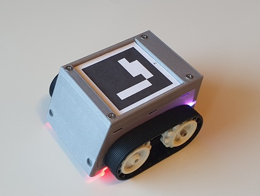
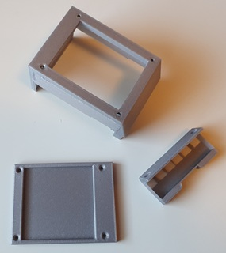
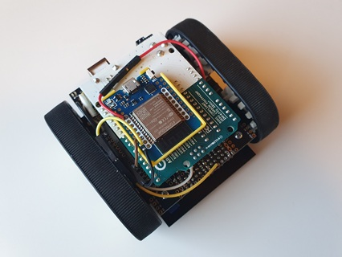

# Zumo Robot Visual Servoing Control

The goal is to develop a simple visual servo control for a differential drive robot. The used robot is the well known Zumo robot. The assembled robot is shown in the following image.

[](./images/robot.jpg)

## Robot Body

For this experiment a specific 3D printed robot body is designed. It allows an ArUco marker to be placed on top of the robot.

The 3D printed parts are shown in the following image.

[](./images/parts.jpg)

## Experiments

Three different scenarios are executed: movement on a square trajectory with side length of 300 mm, movement to a position selected with the cursor and movement over a trajectory denoted with an ArUco markers placed in the workspace of the robot. Video from the experiments is shown below.

https://youtu.be/YRNVU_YvoyM

[](https://youtu.be/YRNVU_YvoyM)

The trajectory execution was improved by adding camera and plane calibrations. Video from experiments after the calibration is shown below.

[](https://youtu.be/JFT7G15iGwE)

## Control Hardware

The robot is controlled by Arduino board with an additional ESP32 board for wireless remote control via HTTP REST or WebSocket APIs. The API references are given below. The used ESP32 is shown in the following image.

[](./images/ESP32.jpg)

## REST API (Port 80)

| Method | Endpoint | Request Body | Description |
|---|---|---|---|
| POST | `/api/drive` | `{"left":150,"right":150}` | Set left and right motor speeds |
| POST | `/api/stop` | — | Stop the motors |
| POST | `/api/led` | `{"on":true}` | Control the LED on pin D13 |
| POST | `/api/buzzer` | `{"freq":880,"ms":200}` | Activate buzzer (frequency in Hz, duration in ms; `freq: 0` = silence) |
| POST | `/api/wifi/reset` | — | Forget Wi-Fi credentials and restart in setup mode |
| GET | `/api/status` | — | Get all device status information |
| GET | `/api/sensors` | — | Get sensor data |
| GET | `/api/battery` | — | Get battery status |
| GET | `/api/button` | — | Get button status |
| GET | `/api/led` | — | Get LED status |
| GET | `/api/wifi` | — | Get Wi-Fi status |

## WebSocket API (Port 81)

Uses JSON text frames for communication.

### Client → Server

Send JSON commands to control the device:

**Drive motors**
```json
{"cmd":"drive","left":150,"right":150}
```

**Stop motors**
```json
{"cmd":"stop"}
```

**Control LED**
```json
{"cmd":"led","on":true}
```

**Control buzzer**
```json
{"cmd":"buzzer","freq":880,"ms":200}
```

**Request device status**
```json
{"cmd":"status"}
```

### Server → Client
The server sends the following responses:

**Command acknowledgment**
```json
{"ok":true,"cmd":"..."}
```

**Error response**
```json
{"error":"..."}
```

**Telemetry**

Periodic device telemetry, sent approximately every POLL_MS while a client is connected:
```json
{"type":"telemetry", ...}
```

**Button event**

Sent when a button event occurs:
```json
{"type":"event","name":"button","pressed":true}
```

